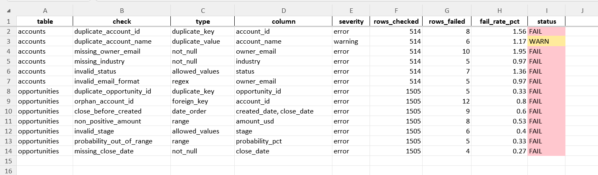
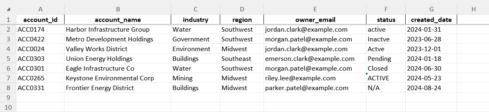
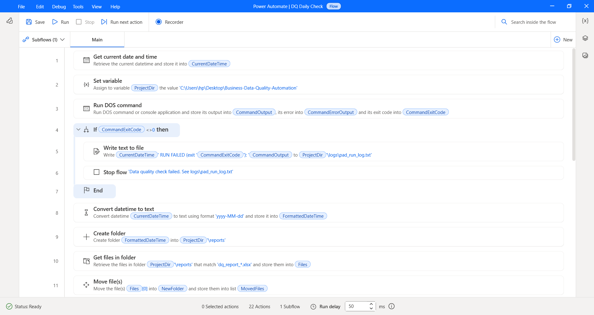
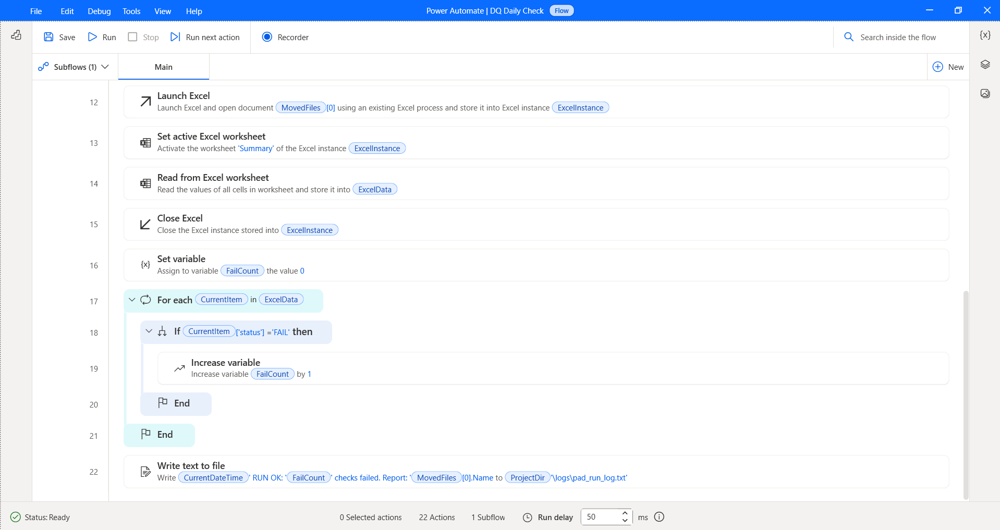
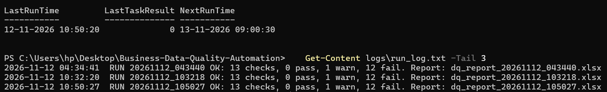
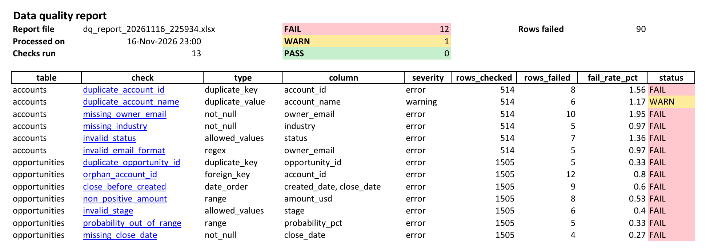
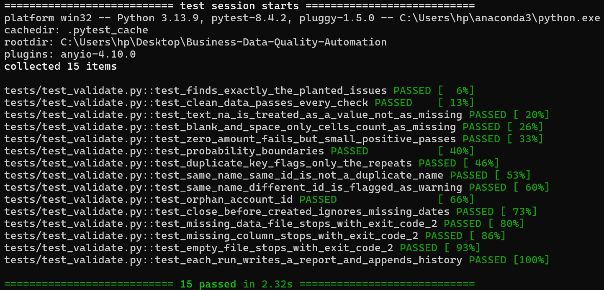

# Business Data Quality Automation

An automated data-quality check for business records. It finds duplicates, missing values, invalid values and broken links between tables, writes an Excel exception report, and runs every day without anyone starting it.

Built with Python (pandas), a YAML rules file, pytest, Power Automate Desktop and Windows Task Scheduler.

> All data in this project is synthetic and generated by a script. It is not connected to any real business system.

---

## The problem

A sales team keeps customer **Accounts** and sales **Opportunities**. Over time the records collect errors: the same company under two IDs, blank required fields, statuses like "Actve", close dates before created dates, opportunities linked to accounts that don't exist. Someone needs to find these regularly and know exactly which rows to fix.

This project does that automatically:

```
Synthetic data (accounts.csv, opportunities.csv) with 90 planted errors
        ↓
Python validation engine  ←  rules in config/rules.yaml
        ↓
Excel exception report (Summary + one sheet of failing rows per check)
+ history log of every run
        ↓
Power Automate Desktop flow: runs the check, handles failures,
files reports into dated folders, reads the Excel summary, logs the result
        +
Windows Task Scheduler: runs the check every day at 09:00
```

---

## Results

The test data has **90 planted errors** across 13 types, listed in `data/expected_issues.csv` as an answer key. The engine finds **all 90, record for record, and flags nothing else**.

| Table | Check | Rule type | Rows failed | Status |
|---|---|---|---:|---|
| accounts | duplicate_account_id | duplicate key | 8 | FAIL |
| accounts | duplicate_account_name | same name, different ID | 6 | WARN |
| accounts | missing_owner_email | required field | 10 | FAIL |
| accounts | missing_industry | required field | 5 | FAIL |
| accounts | invalid_status | allowed values | 7 | FAIL |
| accounts | invalid_email_format | pattern | 5 | FAIL |
| opportunities | duplicate_opportunity_id | duplicate key | 5 | FAIL |
| opportunities | orphan_account_id | must exist in accounts | 12 | FAIL |
| opportunities | close_before_created | date order | 9 | FAIL |
| opportunities | non_positive_amount | range (> 0) | 8 | FAIL |
| opportunities | invalid_stage | allowed values | 6 | FAIL |
| opportunities | probability_out_of_range | range (0–100) | 5 | FAIL |
| opportunities | missing_close_date | required field | 4 | FAIL |



A real report from one run is included as [`docs/sample_report.xlsx`](docs/sample_report.xlsx) (sample output; reports are otherwise generated on each run and not stored in the repository).

Each failed check gets its own sheet listing the exact rows to fix:



---

## How it works

### 1. Rules in a config file
Checks are defined in `config/rules.yaml`, not hard-coded. Each rule has a name, a type, the column(s) it checks and a severity (`error` = must fix, `warning` = review). Supported types: `not_null`, `allowed_values`, `regex`, `range`, `duplicate_key`, `duplicate_value`, `foreign_key`, `date_order`. Adding a check means adding a few lines of YAML.

### 2. Validation engine (`src/validate.py`)
- Reads the rules and both CSV files, runs every check and records the failing rows.
- Writes `reports/dq_report_<timestamp>.xlsx` (Summary sheet coloured by status, plus one sheet per failed check).
- Appends every run to `logs/dq_history.csv` and `logs/run_log.txt`.
- Stops with **exit code 2** and a clear log message if the config or a data file is missing, a column is missing, or a file is empty. Power Automate uses this exit code.

### 3. Power Automate Desktop flow (`DQ Daily Check`)
- Runs the Python check and reads its exit code.
- On failure: writes the reason to `logs/pad_run_log.txt` and stops with an error message.
- On success: creates a dated folder (`reports/YYYY-MM-DD`), moves the newest report into it, opens it in Excel, counts the failed checks on the Summary sheet, and logs a one-line result.




The flow's actions are also saved as text in [`docs/pad_flow.txt`](docs/pad_flow.txt).

### 4. Daily schedule
The free version of Power Automate Desktop cannot schedule flows, so the Python check is scheduled with Windows Task Scheduler at 09:00 daily. The task is set to run on battery, to wake the laptop from sleep, and to catch up after a missed run if the laptop was off. The Power Automate flow is run on demand.



### 5. Excel VBA reporting step (`vba/DQReport.bas`)
After `validate.py` writes a report, the `ProcessLatestReport` macro in `vba/DQ_Macros.xlsm`:
- finds the newest `dq_report_*.xlsx` under `reports/`, including the dated folders created by the Power Automate flow;
- adds a summary block to the Summary sheet: report file, processing time, FAIL / WARN / PASS counts and total rows failed;
- links each check name to its exception sheet;
- exports the Summary sheet as a one-page PDF next to the report (`..._summary.pdf`);
- appends one row per run to `logs/dq_tracker.xlsx`, with a month column for monthly reporting, and never logs the same report twice.

A report that has already been processed is detected and left unchanged, and any error is reported in a message instead of stopping halfway.

Run it: open `vba/DQ_Macros.xlsm`, enable macros, press Alt+F8, choose `ProcessLatestReport`, then Run.



---

## Testing

**Automated tests:** 15 pytest tests in `tests/test_validate.py`, all passing.
- The engine finds exactly the 90 planted issues and nothing else.
- Clean data passes every check.
- Edge cases: "N/A" read as text rather than blank, space-only cells count as missing, amount 0 fails but 0.01 passes, probability 0 and 100 pass but -1 and 101 fail, an exact duplicate row is not also flagged as a duplicate name, missing dates are not wrongly flagged as "close before created".
- A missing file, a missing column and an empty file each stop the run with exit code 2.
- Each run writes a report and adds to the history log.



**Test plan:** [`docs/test_plan.md`](docs/test_plan.md) has 17 test cases across the engine, the Power Automate flow and the schedule. All 17 pass, each with the recorded result and time.

### Defects found during testing

| # | Found by | Problem | Fix |
|---|---|---|---|
| D1 | Comparing results with the answer key | The planted status "N/A" was not flagged. pandas reads "N/A" as a missing value by default, so the allowed-values check skipped it. | Read CSVs so that only truly blank cells count as missing; added a regression test. |
| D2 | Flow failure test | The failure log line had no reason, because the script prints errors to standard output, not the error stream. | Log the command output instead. |
| D3 | Scheduled-task test | The task reported success but never ran. Windows' default task settings do not start tasks on battery power. | Allowed the task to run on battery, start Python directly, and catch up after missed runs. |
| D4 | Flow designer validation | A variable was entered as plain text instead of a variable, so the flow would not run. | Re-entered it as a variable. |

---

## How to run it

Requirements: Windows, Python 3.10+ and the packages in `requirements.txt`.

```powershell
pip install -r requirements.txt

python src\generate_data.py     # create the synthetic data and the answer key
python src\validate.py          # run the checks, write the report and logs
python -m pytest -v             # run the 15 tests
```

### Running it on another machine

Three paths in this project are specific to the author's laptop. Change them to your own before running the flow or the schedule:

| Where | Path to change |
|---|---|
| Power Automate flow, action 2 (`Set variable ProjectDir`) | `C:\Users\hp\Desktop\Business-Data-Quality-Automation` → your project folder |
| Power Automate flow, action 3 (`Run DOS command`) | `C:\Users\hp\anaconda3\python.exe` → the path of your `python.exe` (find it with `where python`) |
| Scheduled task (below) | `$dir` → your project folder |

The Python scripts themselves need no changes; they find their files relative to the project folder.

To schedule the daily check (adjust the folder path):

```powershell
$dir = "C:\path\to\Business-Data-Quality-Automation"
$action   = New-ScheduledTaskAction -Execute "python.exe" -Argument "src\validate.py" -WorkingDirectory $dir
$trigger  = New-ScheduledTaskTrigger -Daily -At 9am
$settings = New-ScheduledTaskSettingsSet -AllowStartIfOnBatteries -DontStopIfGoingOnBatteries -StartWhenAvailable -WakeToRun
Register-ScheduledTask -TaskName "DQ Daily Check" -Action $action -Trigger $trigger -Settings $settings
```

---

## Project structure

```
Business-Data-Quality-Automation/
├── config/
│   └── rules.yaml              # the 13 data-quality rules
├── data/
│   ├── accounts.csv            # synthetic, 514 rows
│   ├── opportunities.csv       # synthetic, 1,505 rows
│   └── expected_issues.csv     # answer key: the 90 planted errors
├── docs/
│   ├── test_plan.md            # 17 test cases and the defect log
│   ├── pad_flow.txt            # Power Automate flow actions as text
│   ├── sample_report.xlsx      # one real exception report (sample)
│   └── screenshots/
├── src/
│   ├── generate_data.py        # creates the data with planted errors
│   └── validate.py             # the validation engine
├── tests/
│   ├── conftest.py
│   └── test_validate.py        # 15 pytest tests
├── vba/
│   ├── DQReport.bas            # VBA module (exported source)
│   └── DQ_Macros.xlsm          # macro workbook that runs it
├── requirements.txt
└── README.md
```

`reports/` and `logs/` are created when the check runs and are not stored in the repository.

---

## Limitations

- The data is synthetic; the project is not connected to a real system.
- The scheduled task runs only while the laptop is on, or catches up after the next login. It cannot start a laptop that is shut down.
- The free Power Automate Desktop cannot schedule flows, so scheduling uses Windows Task Scheduler and the flow runs on demand.

---

**Aditya Ranjan** · [LinkedIn](https://www.linkedin.com/in/aditya-ranjan-data) · [GitHub](https://github.com/beingbrute) · [Portfolio](https://beingbrute.github.io)
